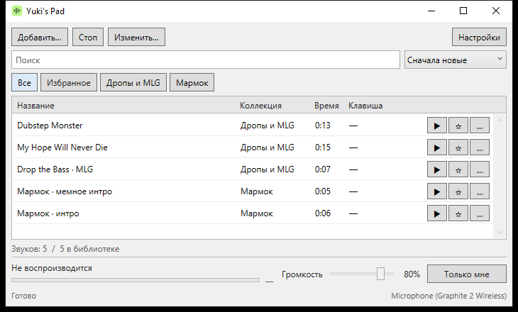

# Yuki’s Pad

Саундпад для Windows: добавляй звуки, обрезай и включай их в Discord через свой микрофон вместе с голосом.

**[Скачать установщик](https://github.com/MaimeD666/Yukisoundpad/releases/latest/download/YukisPadSetup.exe)** · Windows 10/11 x64, .NET Framework 4.8

Запусти установщик, выбери микрофон и укажи его же в Discord. Компонент передачи звука входит в установщик; отдельный виртуальный кабель не нужен. Установка требует прав администратора и кратко перезапускает звук Windows.

- Импорт файлов, обрезка с прослушиванием и экспорт в WAV.
- Горячие клавиши, повтор, избранное и коллекции.
- Переключение между «Только мне» и передачей в микрофон.
- Пять стартовых мемных звуков.

**Ctrl+O** — добавить звук. **Ctrl+Alt+Space** — остановить. Если Discord глушит музыку, отключи шумоподавление; при Push-to-talk удерживай клавишу разговора.

Нативное приложение на C# / WPF с аудиокомпонентом на C++. Библиотека хранится в `%LOCALAPPDATA%\YukisPad` и сохраняется при удалении программы.

[Сборка и проверки](docs/BUILD.md) · [Источники звуков](starter-sounds/manifest.json)
